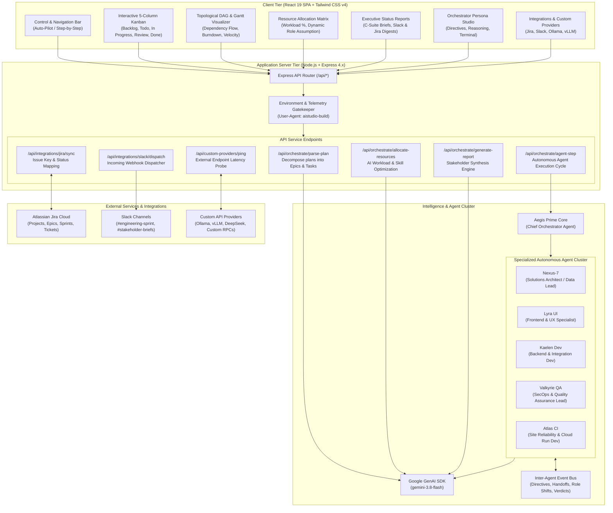

# Aegis Orchestrator 🛡️🤖
### Autonomous AI Project Orchestration, Dynamic Role Allocation & Real-Time Telemetry Engine


---

## 🎯 Purpose

Modern software engineering initiatives often suffer from **fragmented task delegation, specialist burnout, stale status tracking, and manual reporting overhead**. 

**Aegis Orchestrator** resolves this by operating as an **Autonomous Project Management Engine**. It digests high-level curated project specs, automatically decomposes them into epics and actionable tasks, models topological prerequisite dependencies, and orchestrates an autonomous team of specialized AI agents. 

Crucially, sub-agents **dynamically assume specialized roles** (such as *Solutions Architect*, *Penetration Tester*, *Design Systems Lead*, or *SRE*) based on emerging technical bottlenecks, project constraints, and inter-agent communication history. Real-time execution is surfaced on an interactive Kanban board, visual DAG diagrams, and automated executive digests with bi-directional Atlassian Jira and Slack synchronization.

---

## 🏗️ Detailed Architectural Diagram

### 1. System Architecture & Information Flow (Mermaid)



---

### 2. Comprehensive Component Layer Diagram

```
+---------------------------------------------------------------------------------------------------+
|                                     AEGIS ORCHESTRATOR PLATFORM                                    |
+---------------------------------------------------------------------------------------------------+
|  PRESENTATION LAYER (React 19 + Tailwind CSS)                                                      |
|  +-------------------------+  +--------------------------+  +----------------------------------+  |
|  | Kanban Board Component  |  | Diagrams & Progress      |  | Resource Allocation Matrix       |  |
|  | - 5-Column Lifecycle    |  | - Directed Graph (DAG)   |  | - 40h Capacity Buffer Gauge      |  |
|  | - Execution Pulse Glow  |  | - Sprint Gantt Timeline  |  | - Workload Rebalance Engine      |  |
|  | - Dependency Guardrails |  | - Burndown & Velocity    |  | - Dynamic Role Transition Studio |  |
|  +-------------------------+  +--------------------------+  +----------------------------------+  |
|  +-------------------------+  +--------------------------+  +----------------------------------+  |
|  | Stakeholder Reports     |  | Orchestrator Studio      |  | Integrations & Providers Hub     |  |
|  | - C-Suite Executive KPI |  | - Persona Directives     |  | - Jira Cloud Webhook Mapping     |  |
|  | - Blocker Forecast      |  | - Autonomy Mode Selector |  | - Slack Block Kit Broadcaster    |  |
|  | - Markdown/PDF Export   |  | - Real-Time Terminal     |  | - Custom Endpoint Latency Tester |  |
|  +-------------------------+  +--------------------------+  +----------------------------------+  |
+---------------------------------------------------------------------------------------------------+
|  ORCHESTRATION & STATE MANAGEMENT (Client Hooks + Engine Cycle Controller)                         |
|  - Auto-Pilot Loop (Autonomous execution with interval governor)                                   |
|  - Step-by-Step Cycle Runner (Deterministic debugging and human-in-the-loop control)                |
|  - Inter-Agent Event Log & Real-Time Toast Notification Dispatcher                                |
+---------------------------------------------------------------------------------------------------+
|  BACKEND APPLICATION SERVER (Node.js + Express 4.21 + Vite Middleware)                            |
|  +---------------------------------------------------------------------------------------------+  |
|  |  /api/orchestrate/parse-plan        -> Plan decomposition into Epics, Tasks, Subtasks       |  |
|  |  /api/orchestrate/allocate-resources  -> Workload balancing, skill match scoring & role fit   |  |
|  |  /api/orchestrate/agent-step        -> Agent task execution, deliverable & role assumption   |  |
|  |  /api/orchestrate/generate-report    -> Executive summary, KPI extraction, Slack digest       |  |
|  |  /api/integrations/jira/sync        -> Bi-directional ticket sync & issue payload mapping    |  |
|  |  /api/integrations/slack/dispatch   -> Real/Simulated webhook posting to Slack channels      |  |
|  |  /api/custom-providers/ping         -> REST / RPC endpoint latency benchmark & response test|  |
|  +---------------------------------------------------------------------------------------------+  |
+---------------------------------------------------------------------------------------------------+
|  AI INTELLIGENCE & REASONING TIER (@google/genai SDK)                                             |
|  - Google Gemini 3.8 Flash (`gemini-3.8-flash`)                                                   |
|  - Server-side telemetry header (`httpOptions.headers['User-Agent'] = 'aistudio-build'`)          |
|  - Safe heuristic fallbacks ensuring continuous offline and zero-downtime execution                |
+---------------------------------------------------------------------------------------------------+
```

---

## ✨ Features

### 1. 📋 Curated Plan Ingestion & Decomposition
- **Curated Templates**: Ingest ready-to-use plans (Enterprise AI MVP, PCI-DSS Payment Gateway, Clinical Telemetry) or paste custom markdown/bulleted product specs.
- **Automated Breakdown**: Decomposes high-level visions into structured Epics, Granular Tasks, estimated hours, acceptance subtasks, tags, and suggested specialist roles.
- **One-Click Adoption**: Instantly initialize the Kanban board and roadmap from parsed plans.

### 2. 🗂️ Interactive Kanban Board with Real-Time Updates
- **5-Column Pipeline**: `Backlog` ➔ `To Do` ➔ `In Progress` ➔ `Review & QA` ➔ `Done`.
- **Live Execution Pulse**: Real-time visual indicator and glowing pulse on tasks currently being worked on by an active agent.
- **Dependency Guardrails**: Automatically warns when a task is blocked by unfinished prerequisite dependencies (e.g., `Blocked by AEG-101`).
- **Comprehensive Task Details**: View and edit subtask checklists, priority badges, Jira keys, tags, and real technical deliverables (code artifacts, schema contracts, OpenAPI specs).

### 3. 🧭 Visual Analytics & Progress Tracking Diagrams
- **Interactive DAG Dependency Flow**: High-resolution SVG graph depicting nodes, directed bezier curves with arrowheads, status indicators, and critical path highlights.
- **Sprint Gantt Timeline**: Day 1–14 sprint milestone timeline showing scheduled task bars, durations, and assignee avatar chips.
- **Sprint Burndown Chart**: Compares ideal burndown trajectory with actual completed story points/hours remaining.
- **Agent Velocity & Workload Distribution**: Real-time visualization of allocated hours against 40-hour capacity thresholds.

### 4. 👥 AI-Driven Resource Allocation & Dynamic Role Assumption
- **Workload Balancing**: Real-time load percentage calculations identifying underloaded, balanced, or overloaded agents.
- **AI Rebalance**: Evaluates agent skill sets, task difficulty, priority, and backlog to redistribute tasks optimally.
- **Dynamic Role Assumption**: Agents change roles dynamically based on project requirements (e.g. Nexus-7 shifting from *Solutions Architect* to *Data Governance Lead*; Valkyrie QA assuming *Penetration Tester* for compliance audits).
- **Role Transition History**: Complete audit trail of past role transitions and rationales.

### 5. 📊 Automated Stakeholder Status Reporting
- **Executive Scorecard**: Instant synthesis of sprint completion rate, velocity, blocker counts, and sprint health (*Green / Amber / Red*).
- **Executive Narrative**: High-level summary crafted for C-Suite and product leadership.
- **Technical Deliverables & Risk Mitigations**: Outlines key architectural wins and provides AI mitigation plans for potential bottlenecks.
- **Digests**: Pre-formatted Markdown digests tailored for **Slack Block Kit** and **Atlassian Jira Release Notes**.
- **Print / PDF View**: One-click printable executive brief.

### 6. ⚙️ Orchestrator Persona Studio & Directives Terminal
- **Agent Governance**: Customize the Chief Orchestrator's name, avatar, and system prompt directives.
- **Autonomy Settings**: Switch between *Full Autonomous*, *Semi-Autonomous (Recommended)*, and *Step-by-Step Human Approval*.
- **Cognitive Controls**: Configure reasoning level (*Deep Thinking* vs *Standard*) and risk tolerance (*Conservative*, *Balanced*, *Aggressive*).
- **Directives Terminal**: Communicate live with the Orchestrator via an integrated chat terminal to inject ad-hoc requirements or reprioritize tasks.

### 7. 🔌 Jira, Slack & Custom API Providers
- **Atlassian Jira**: Bi-directional webhook synchronization, issue key generation, and ticket status mapping.
- **Slack Notifications**: Webhook integration posting real-time alerts to `#engineering-sprint` and `#stakeholder-briefs`.
- **Custom API Providers**: Register custom REST / RPC / LLM endpoints (e.g., local Ollama, vLLM, DeepSeek instances, or custom CI/CD pipelines) with real-time latency ping testing.
- **Inter-Agent Message Bus**: Live chronological feed of directives, handoffs, deliverables, and role shifts.

---

## 💻 Tech Stack

| Component | Technology | Version | Description |
| :--- | :--- | :--- | :--- |
| **Frontend Framework** | React | `^19.0.1` | Next-generation React with functional components and hooks |
| **Styling** | Tailwind CSS | `^4.3.3` | High-performance CSS framework with `@tailwindcss/vite` |
| **Icons** | Lucide React | `^0.546.0` | Modern, clean icon set |
| **Animation** | Motion | `^12.23.24` | Smooth transitions and layout animations |
| **Backend Runtime** | Node.js + Express | `^4.21.2` | Full-stack API server hosting orchestrator endpoints |
| **AI Intelligence** | `@google/genai` | `^2.4.0` | Official Google GenAI SDK powered by `gemini-3.8-flash` |
| **Language** | TypeScript | `^7.0.2` | Strict end-to-end type safety |
| **Build Tool** | Vite | `^8.3.0` | Instant HMR and production bundle optimization |

---

## 🚀 Installation & Local Setup

### Prerequisites
- **Node.js**: Version `20.x` or higher (Node `22.x` recommended).
- **npm** or **pnpm**: Version `9.x` or higher.
- *(Optional)* **Gemini API Key**: If you have a Google AI Studio API key, set it in `.env` to enable full real-time Gemini generation (built-in intelligent heuristic fallbacks ensure the app works out of the box even without an active key).

### Step 1: Clone or Open the Project
Clone the repository (or open your downloaded project directory):
```bash
git clone <repository-url>
cd aegis-orchestrator
```

### Step 2: Install Dependencies
```bash
npm install
```

### Step 3: Configure Environment Variables
Copy `.env.example` to `.env`:
```bash
cp .env.example .env
```

Open `.env` and verify your settings:
```env
# Optional Gemini API Key (Automatically injected in AI Studio)
GEMINI_API_KEY="your_gemini_api_key_here"

# Application URL
APP_URL="http://localhost:3000"
```

### Step 4: Run the Development Server
```bash
npm run dev
```

The Express server with embedded Vite middleware will start:
```
Aegis Orchestrator server running on http://0.0.0.0:3000
```
Open **[http://localhost:3000](http://localhost:3000)** in your browser.

### Step 5: Build for Production
To create a production-ready bundle and run:
```bash
npm run build
npm start
```

---

## 📖 How to Use: Step-by-Step Guide

### 1. Ingesting & Decomposing a Project Plan
1. Click the **"Ingest Plan"** button in the top navigation bar.
2. Choose one of the curated enterprise templates (e.g., *Enterprise AI Workflow MVP*) or select **"Clear / New Custom Plan"** to paste your own product spec.
3. Click **"Decompose & Orchestrate Plan with AI"**.
4. Aegis will parse the plan into epics, granular tasks, estimated effort, and recommended agent roles.
5. Click **"Adopt Plan to Kanban Board"** to populate the workspace.

### 2. Managing the Autonomous Execution Loop
- **Auto-Pilot Mode**: Click the green **"Auto-Pilot"** button in the header. Aegis will continuously cycle through eligible tasks, advancing them through *In Progress*, *Review*, and *Done* stages while generating technical code deliverables and broadcasting handoff messages.
- **Step-by-Step Mode**: Click **"Next Cycle"** to trigger a single deterministic agent execution step.
- **Manual Drag / Click Transitions**: On the Kanban board, click the forward (`→`) or backward (`←`) arrow on any task card to move it across columns.

### 3. Inspecting Deliverables & Running Specific Tasks
1. Click on any task card on the Kanban board to open the **Task Detail Modal**.
2. Review acceptance criteria subtasks and check them off interactively.
3. View generated deliverables (source code, schemas, tests).
4. Click **"Execute Agent Step on This Task"** to instruct the assigned specialist to perform immediate work on that specific item.

### 4. Viewing Diagrams of Progress
Navigate to the **"Diagrams & Progress"** tab:
- **DAG Dependency Flow**: Inspect the topological graph to verify prerequisites and identify critical path bottlenecks.
- **Sprint Gantt Timeline**: Check scheduled days 1–14 and task durations.
- **Sprint Burndown**: Track actual progress against the ideal burndown trajectory.
- **Velocity & Allocation**: Review current agent workload vs capacity.

### 5. AI-Driven Workload Balancing & Role Assumption
1. Navigate to the **"Resource Allocation"** tab.
2. Check each agent’s capacity percentage (e.g. 75% Balanced, 90% Overloaded).
3. Click **"AI Rebalance Workload"** to trigger the AI optimization engine to reassign tasks based on domain skills.
4. Click **"Assume Role"** on any agent card to dynamically shift their title and role (e.g., assign *Lead Penetration Tester* to Valkyrie QA).

### 6. Synthesizing Stakeholder Reports
1. Navigate to the **"Stakeholder Reports"** tab.
2. Click **"Generate Stakeholder Brief"**.
3. Review the **Executive Narrative**, **Sprint Health rating**, **Key Highlights**, and **Risk Mitigations**.
4. Click **"Copy"** on the Slack digest or Jira release notes, or click **"Dispatch to Slack"** to broadcast to your team.
5. Click **"Print / PDF"** to generate an executive briefing document.

### 7. Customizing the Orchestrator & Registering Custom Providers
1. In the **"Orchestrator Studio"** tab:
   - Edit the Chief Orchestrator's persona and system prompt directives.
   - Adjust autonomy mode, reasoning depth, and risk tolerance.
   - Use the **Directives Terminal** on the right to chat directly with Aegis.
2. In the **"Jira & Slack Sync"** tab:
   - Set up your Jira Cloud URL and test synchronization.
   - Configure your incoming Slack webhook URL.
   - Click **"Register Custom Endpoint"** to link your own local Ollama, vLLM, or custom microservice endpoints and ping them for latency.

---

## 📡 API Reference

| Method | Endpoint | Description |
| :--- | :--- | :--- |
| `GET` | `/api/health` | Health probe returning service status and Gemini API key availability |
| `POST` | `/api/orchestrate/parse-plan` | Decomposes project text into Epics, Tasks, Subtasks, and Roles |
| `POST` | `/api/orchestrate/allocate-resources` | Calculates capacity utilization and provides optimized task assignments |
| `POST` | `/api/orchestrate/agent-step` | Simulates an execution cycle, producing deliverables and status changes |
| `POST` | `/api/orchestrate/generate-report` | Synthesizes an executive status report with KPIs and formatted digests |
| `POST` | `/api/integrations/jira/sync` | Simulates or dispatches Jira issue creation and status transitions |
| `POST` | `/api/integrations/slack/dispatch` | Posts formatted alerts to real or simulated Slack webhook channels |
| `POST` | `/api/custom-providers/ping` | Tests external user-defined REST / LLM endpoints with latency measurement |

---

## 🔒 Security & Data Privacy

- **Server-Side API Key Isolation**: All Gemini SDK interactions occur exclusively on the Express server tier via `process.env.GEMINI_API_KEY`. No API keys or credentials are ever exposed to client bundles or browser consoles.
- **Fail-Safe Fallbacks**: If external API connectivity is constrained or offline, built-in algorithmic and heuristic engines guarantee 100% operational uptime without UI disruptions.
- **Sanitized Webhooks**: External webhook requests utilize timeout boundaries (`AbortSignal.timeout`) to prevent thread starvation.

---

## 📄 License

This project is licensed under the **Apache License 2.0**.
